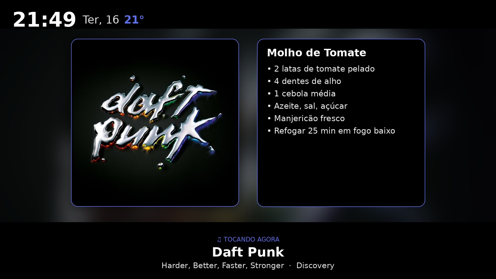
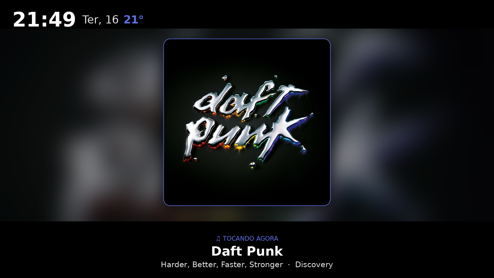
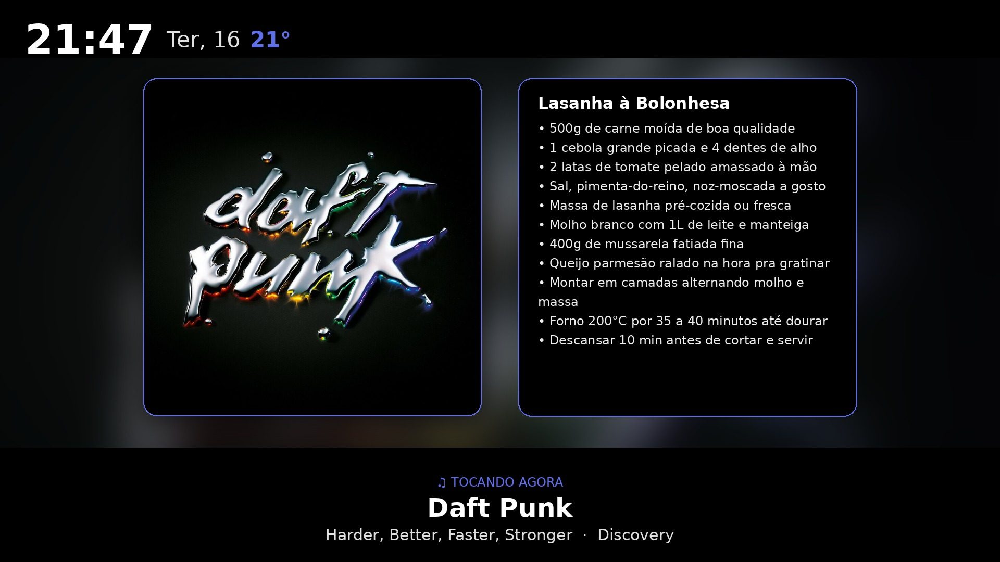

# kitchen-cast

A Home Assistant + Chromecast reference build that turns a kitchen TV into a photo frame which switches to album art and a recipe overlay whenever music starts playing.

  



<p align="center">
  
  
</p>

## Overview

Cooking with a recipe usually means a phone propped against the flour bag and a separate app for
music. Off-the-shelf Chromecast dashboards show one thing at a time and do not react to what a
different speaker is playing. Kitchen Cast uses music as the only trigger: when a speaker in another
room starts playing, the kitchen TV flips from a photo slideshow to the current album art, optionally
with a TV-condensed recipe, and an AI worker builds a matching YouTube Music playlist.

This is a reference implementation for porting to another Home Assistant setup, not a one-click
installer. The on-screen text and web UI are in Portuguese because the production install serves a
Portuguese-speaking household.

## Features

- Renders a 1920x1080 photo slideshow frame with clock, current temperature and a 3-day Open-Meteo forecast, plus EXIF date and reverse-geocoded city of each photo.
- Switches automatically to a "now playing" frame (album art, blurred background, accent color extracted from the cover, artist/title/album) when the trigger speaker plays.
- Falls back from YouTube Music album art to the YouTube video thumbnail, then to Deezer artist images.
- Overlays an "armed" recipe next to the album art, auto-sizing the font (31 px down to 20 px) to fit.
- Reads a hand-written `TV:` block from each plain-text recipe for the TV overlay, while the web page shows the full recipe.
- Plays photos as a deck: every photo once per pass, consecutive photos from different folders whenever possible, reshuffled daily and reloaded when the photo list changes.
- Serves a mobile web app (FastAPI) to pick a recipe, arm it on the TV and request a new AI-curated playlist, or jump straight to one of 5 random existing playlists.
- Accepts an AI playlist only after the worker exits cleanly and an independent delivery check (the Rolo curator's `rolo_curate.py delivery`) confirms it.
- Disarms the recipe automatically after a 30-minute window with no play or after the speaker has been stopped for 15 minutes, never while music is playing.

## How it works

The TV Chromecast only ever displays one URL, `http://<ha-host>:8123/local/current.jpg?t=<timestamp>`.
Everything else decides which process writes that file.

```
 trigger speaker ──state──▶ Home Assistant automations ──play_media──▶ TV Chromecast
 (media_player)              │            │                               ▲
                             │ starts     │ starts                        │ /local/current.jpg
                             ▼            ▼                               │
                   slideshow_gen.py   start_musica_helper.py ─▶ musica_slideshow.py
                   (photo mode)       reads .music_state.txt    (music mode, reads
                             │                                   music_recipe.json each frame)
                             └──────────── write /config/www/current.jpg ───┘

 phone ─▶ web app (app/app.py) ──REST──▶ Home Assistant: shell_command curls
            │                              /api/pending_recipe -> music_recipe.json,
            │                              input_boolean on, timer start
            └─ docker exec ─▶ headless LLM worker + YouTube Music MCP ─▶ playlist URL
```

Non-obvious decisions:

- **One image file, two renderers.** Only one renderer runs at a time; the automations kill one and
  start the other. The Chromecast never knows the difference. Both start paths take an exclusive
  `flock` on `/config/.slideshow_renderer.lock`, and a `command_line` watchdog sensor
  (`slideshow_gen_status`, every 60 s) restarts the photo renderer if nothing is drawing.
- **Home Assistant pulls the recipe.** The web app never writes to the Home Assistant host and holds no
  SSH key; a `shell_command` curls `/api/pending_recipe`. The app only carries a Home Assistant token.
- **Metadata goes through a `command_line` sensor**, because `shell_command` does not render Jinja2.
  The sensor writes `state|media_content_id|artist|title|entity_picture|album` to `/config/.music_state.txt`.
- **The TV frame is pushed twice** (about +4 s and +12 s) because the speaker can update the content id
  before artist/title, which otherwise shows the previous track.
- **Playlist generation is the only AI step** and is isolated: if it fails, the recipe is still armed.
  The worker runs `claude -p` with the DJ skill file (`ROLO_SKILL_FILE`) appended as the system prompt,
  re-read on every job. A non-zero exit is a failure, and a URL found in the output is returned only
  if `ROLO_DELIVERY_CMD --playlist-id <id> --since <start>` prints `{"ok": true}`, so a model that
  claims success without a validated delivery is rejected.
- **The TV text is authored, not generated.** Recipes carry their own short `TV:` block; without it the
  first `MAX_TV_LINES` lines are sent and the renderer shrinks or truncates to fit.

More detail: [docs/ARCHITECTURE.md](docs/ARCHITECTURE.md), [docs/SYSTEM_CONTRACTS.md](docs/SYSTEM_CONTRACTS.md)
and [docs/AI_PORTING_GUIDE.md](docs/AI_PORTING_GUIDE.md).

| Path | Contents |
|---|---|
| `app/` | FastAPI web app, Dockerfile, compose example, `.env.example` |
| `slideshow/` | Photo renderer, music renderer, music helper, renderer watchdog and photo-list builder (run inside Home Assistant) |
| `homeassistant/` | Sanitized `configuration.yaml` and `automations.yaml` snippets |
| `examples/` | Sample active recipe JSON |
| `docs/` | Architecture, contracts, porting guide |
| `design/` | UI components and color tokens extracted from the web app |
| `preview/` | Real and mock-up TV frames used to choose the layout |

## Requirements

- Home Assistant with shell access to `/config` and Python 3 with Pillow (the renderers run there).
- A Chromecast on the TV and a separate `media_player` used as the music trigger (for example a Chromecast Audio).
- Docker host for the web app (image is based on `python:3.11-slim`).
- Home Assistant long-lived access token.
- For AI playlists: a container running a headless `claude` CLI with a YouTube Music MCP server, reachable via the Docker socket, plus the Rolo music-curation skill (a `SKILL.md` and its `rolo_curate.py`) inside that container.
- For the "play now" shortcuts: a `ytmusicapi` auth file.
- Internet access to Open-Meteo, BigDataCloud reverse geocoding, YouTube and Deezer (no API keys needed).

## Quick start

1. Clone the repo:

   ```bash
   git clone https://github.com/cascodigital/kitchen-cast.git
   cd kitchen-cast
   ```

2. Copy `slideshow/*.py` and `slideshow/*.sh` to Home Assistant `/config/`, merge
   `homeassistant/configuration.snippets.yaml` and `homeassistant/automations.snippets.yaml`, and replace
   `media_player.SALA`, `media_player.COZINHA`, `HA_HOST` and `APP_HOST` with your values. If your photos
   are not in `/media/media/Pictures`, change the `PHOTOS_DIR` default in `slideshow_gen.py` and
   `update_slideshow.sh`, then build the photo list once:

   ```bash
   sh /config/update_slideshow.sh
   # fotos.json updated: <n> photos
   ```

3. Configure and start the web app:

   ```bash
   cd app
   cp .env.example .env                                   # set HASS_TOKEN
   cp docker-compose.example.yml docker-compose.yml       # set HASS_URL and volume paths
   docker compose up -d --build
   ```

4. Check that it is up:

   ```bash
   curl http://localhost:8095/healthz
   # ok
   ```

Then open `http://<docker-host>:8095/`, pick a recipe and start music on the trigger speaker.

## Configuration

Web app (`app/app.py`, environment variables):

| Variable / key | Required | Default | Description |
|---|---|---|---|
| `HASS_TOKEN` | Yes | empty | Home Assistant long-lived access token |
| `HASS_URL` | No | `http://homeassistant.local:8123` | Home Assistant base URL |
| `RECIPES_DIR` | No | `/recipes` | Folder of `.txt` recipes, one file per recipe |
| `WORKER_CONTAINER` | No | `claude-worker` | Container that runs the headless LLM CLI for playlists |
| `YTM_MCP_CONFIG` | No | `/home/claude/ai/mcp/youtube-music/mcp-config.json` | MCP config path inside the worker container |
| `YTM_AUTH_FILE` | No | `/auth/ytmusic_auth.json` | `ytmusicapi` auth file used to list existing playlists |
| `MAX_TV_LINES` | No | `12` | Maximum recipe lines sent to the TV |
| `QUICK_COUNT` | No | `5` | Number of random "play now" playlist shortcuts |
| `RECIPE_TIMER_ENTITY` | No | `timer.recipe_window` | Home Assistant timer started when a recipe is armed; must match the snippet |
| `WORKER_USER` | No | `claude` | User that runs the CLI and the delivery check inside the worker |
| `ROLO_SKILL_FILE` | No | `/home/claude/rolo/SKILL.md` | DJ skill file inside the worker, appended as the system prompt; its folder is the working directory |
| `ROLO_DELIVERY_CMD` | No | `python3 <skill dir>/rolo_curate.py delivery` | Command run in the worker with `--playlist-id <id> --since <epoch>`; must print `{"ok": true}` and exit 0 |

Renderers (`slideshow/*.py`):

| Variable / key | Required | Default | Description |
|---|---|---|---|
| `WEATHER_LAT` / `WEATHER_LON` | No | `40.7128` / `-74.0060` | Forecast coordinates (placeholder city) |
| `PHOTOS_DIR` | No | `/media/media/Pictures` | Photo folder (`slideshow_gen.py`, `update_slideshow.sh`) |
| `PHOTOS_JSON` | No | `/config/www/fotos.json` | JSON array of photo paths relative to `PHOTOS_DIR` |
| `LOCK_FILE` | No | `/config/.slideshow_renderer.lock` | Renderer lock (`start_slideshow_safe.sh`; fixed in `start_musica_helper.py`) |
| `FONT_DIR` (constant) | No | Home Assistant OS DejaVu fonts path | TrueType fonts; falls back to the PIL default font |
| `INTERVAL` (constant) | No | `25` photo / `15` music | Seconds between frames |

Home Assistant shell commands do not pass environment variables, so for the renderers either edit the
defaults or prefix the command (`PHOTOS_DIR=... sh /config/update_slideshow.sh`).

Home Assistant entities used: `input_boolean.recipe_armed`, `timer.recipe_window`, `sensor.music_state_writer`,
`sensor.slideshow_gen_status`,
the `shell_command`s in the snippet, and the scripts `slideshow_foto_atual` / `slideshow_foto_atual_force`
(not included; they call `media_player.play_media` with the cache-busted image URL).

## Usage

Recipe files are plain text, one line per ingredient or step (a leading `-` is stripped). Everything
after a line that reads exactly `TV:` is the TV version (first `MAX_TV_LINES` lines); everything before
it is shown on the web page. Put the `TV:` block last:

```text
Chicken hearts: 700 g
Preheat the oven to 200 C for 15 minutes.
...
TV:
Chicken hearts: 700 g
Oven: 200 C, preheated
Turn at 15 min
```

The overlay can also be armed without the web app by writing a file like
[examples/music_recipe.example.json](examples/music_recipe.example.json) to `/config/music_recipe.json`.

Web app routes:

| Route | Purpose |
|---|---|
| `GET /` | Recipe list |
| `GET /r/<id>` | Recipe view with playlist form and shortcuts |
| `POST /cook` | Arm the recipe and start a playlist job |
| `GET /job/<id>` | Poll job status |
| `GET /quick?rid=<id>&list=<playlist_id>` | Arm the recipe and redirect to an existing playlist |
| `GET /api/pending_recipe` | Latest armed recipe JSON, pulled by Home Assistant |
| `GET /healthz` | Liveness check |

## Limitations

- Reference build, not an installer: entity ids, Home Assistant paths and the font directory are hard-coded and must be adapted.
- The timer id is shared by the app (`RECIPE_TIMER_ENTITY`) and the snippets (`timer.recipe_window`); if you rename one, rename the other, or arming starts a timer that does not exist and the recipe is never auto-disarmed.
- Recipes without a `TV:` block send their first lines unchanged; there is no automatic condensing.
- AI playlists require the external Rolo skill and its `rolo_curate.py delivery` record inside the worker; without them every playlist job fails (the "play now" shortcuts still work).
- The `slideshow_foto_atual` scripts that cast the image to the TV are referenced but not included.
- Job and recipe state live in memory (single uvicorn worker, single user); a restart clears them.
- The web app has no authentication and needs the Docker socket; keep it on a trusted network or behind an auth proxy.
- Playlist creation depends on a headless `claude` CLI with a YouTube Music MCP server; other providers need a new worker call and URL parser.
- Weather timezone is fixed to `America/Sao_Paulo` in the Open-Meteo requests.
- UI and on-screen TV text are Portuguese only.

## License

MIT — see [LICENSE](LICENSE).
